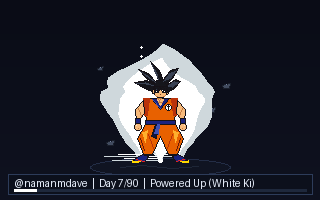

# Hi, I'm Naman 👋

  

  <b>🔥 The 90-Day Saiyan Streak Challenge</b> 
  <i>Goku evolves dynamically based on my continuous GitHub commit streak. If the streak breaks, he drops back to Base form!</i>

---

### ⚡ Transformation Ladder (0 ➔ 90 Days)

| Streak | Transformation | Ki Aura & Visual Effects |
|---|---|---|
| **0 – 3 Days** | **Base Form** | Classic black hair, relaxed idle breathing |
| **4 – 7 Days** | **Powered Up** | Shimmering white ki aura waves |
| **8 – 14 Days** | **Kaio-ken (界王拳)** | Blazing crimson/scarlet flame aura |
| **15 – 24 Days** | **Super Saiyan (SSJ1)** | Spiky golden hair, bright golden ki aura |
| **25 – 34 Days** | **Super Saiyan 2 (SSJ2)** | Sharper golden spikes + crackling blue electrical sparks |
| **35 – 44 Days** | **Super Saiyan 3 (SSJ3)** | Waist-length golden mane, heavy lightning discharge |
| **45 – 54 Days** | **Super Saiyan 4 (SSJ4)** | Wild black mane, crimson body fur, swaying monkey tail |
| **55 – 64 Days** | **Super Saiyan God (SSG)** | Lean frame, ruby/magenta glowing divine flame |
| **65 – 74 Days** | **Super Saiyan Blue (SSB)** | Serene azure/cyan godly ki + floating sparkles |
| **75 – 84 Days** | **SSB Kaio-ken (x20)** | Dual aura: cyan god ki wrapped in roaring crimson flame |
| **85 – 89 Days** | **Ultra Instinct -Sign-** | Flowing heat haze, glowing silver irises |
| **90+ Days** | **Mastered Ultra Instinct (MUI)** | Pure celestial silver hair & eyes, transcendent stardust aura |

---
