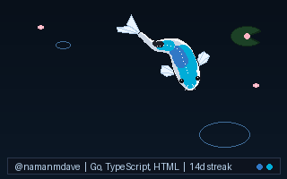

# Hi, I'm Naman 👋

<p align="center">
  
</p>

<p align="center">
  <i>A living Nishikigoi swimming in my profile pond, dynamically patterned by my coding activity.</i>
</p>

---

### 🎏 About This Git Koi

This koi is generated and updated automatically via a 100% transparent, self-contained Python script ([`git_koi.py`](./git_koi.py)) using GitHub Actions.

- **Zero third-party binaries or untrusted dependencies**: Built purely with Python & Pillow.
- **Dynamic Nishikigoi Patches**: Scaled and colored by active repository languages.
- **Fluid Kinematics**: Trailing-spine physics with undulating fins, ripples, and drifting sakura blossoms.

<details>
<summary><b>🛠️ How to run locally</b></summary>

```bash
# Install Pillow
pip install pillow

# Generate your own Koi
python3 git_koi.py --username namanmdave --output koi.gif
```
</details>
